# `/workflow` – Ablaufdiagramm

Die **Main Session** steuert den Ablauf. Sie behält Benutzerentscheidungen,
Branch-Erstellung, Status und finale Abnahme; die sechs Agents übernehmen klar
begrenzte Rollen. Das Diagramm zeigt einen neuen Auftrag inklusive Review-Schleife.

```mermaid
flowchart TD
    Start(["/workflow Aufgabe, Ticket oder URL"])

    subgraph Vorbereitung["1. Auftrag und Recherche"]
        Auftrag{"Auftrag vorhanden?"}
        Nachfrage["Main: Auftrag oder Ticket erfragen"]
        Preflight{"Main: Repository, HEAD, Checkout,<br/>Setup und Agent-Rechte geprüft und gültig?"}
        Task["Main: TASK_DIR unter ~/.pi/tasks/UUID anlegen<br/>request.md und state.json schreiben<br/>correctionRounds = 0; reviewIndex = 0"]
        Research["researcher: Repository und MCP-Quellen lesend recherchieren<br/>research.md schreiben"]
        Fragen{"Offene Fragen?"}
        Antworten["Main: Fragen gesammelt mit Benutzer klären<br/>Antworten in request.md festhalten<br/>bei blockierenden Fragen auf Antwort warten"]
        Branch["Main: Git-Status und unveränderten Basis-HEAD erneut prüfen<br/>lokalen Feature-Branch erstellen"]

        Start --> Auftrag
        Auftrag -->|Nein| Nachfrage
        Nachfrage --> Auftrag
        Auftrag -->|Ja| Preflight
        Preflight -->|Ja| Task
        Preflight -->|Nein| Blocked
        Task --> Research
        Research --> Fragen
        Fragen -->|Ja| Antworten
        Fragen -->|Nein| Branch
        Antworten --> Branch
    end

    subgraph Planung["2. Planung und verbindliche Benutzerfreigabe"]
        Plan["planer: plan.md erstellen oder überarbeiten<br/>bei Review-Findings nur neue Korrekturphasen anhängen"]
        PlanAdvisor["advisor: begrenzte Planungsfrage beantworten"]
        Planpruefung["Main: Scope, Phasen, Tasks, IDs, Abhängigkeiten<br/>und Akzeptanzprüfungen kontrollieren<br/>neue blockierende Fragen mit Benutzer klären"]
        Vorlage["Main: bisherige Freigabe löschen; Plan-SHA-256 ermitteln<br/>stage = awaiting-plan-approval speichern<br/>Plan zusammenfassen, Pfad nennen und Benutzer fragen"]
        Entscheidung{"Benutzerentscheidung<br/>zum aktuellen Plan?"}
        Aenderungen["Main: Änderungswünsche in request.md festhalten"]
        Pause(["Pausiert: keine Umsetzung<br/>auf ausdrückliche Freigabe warten"])
        Zustimmung["Main: ausdrückliche Zustimmung dokumentieren<br/>planApproval mit Antwort und Plan-SHA-256 speichern"]
        Freigabe{"Main: Freigabe vorhanden<br/>und SHA-256 noch passend?"}

        Plan -.->|Optional: konkrete Frage| PlanAdvisor
        PlanAdvisor -.->|Bericht an planer| Plan
        Plan --> Planpruefung
        Planpruefung --> Vorlage
        Vorlage --> Entscheidung
        Entscheidung -->|Änderungswünsche| Aenderungen
        Aenderungen --> Plan
        Entscheidung -->|Ablehnung oder keine Zustimmung| Pause
        Entscheidung -->|Ausdrückliche Zustimmung| Zustimmung
        Zustimmung --> Freigabe
        Freigabe -->|Nein| Vorlage
    end

    subgraph Umsetzung["3. Sequenzielle Umsetzung"]
        Manager["manager: Freigabe prüfen; offene Phasen in Reihenfolge abarbeiten<br/>jeweils genau einen worker beauftragen und dessen Ende abwarten<br/>Worker-Evidenz prüfen; nur belegte Tasks und Phasen abhaken<br/>manager-round-N.md schreiben"]
        ManagerAdvisor["advisor: begrenzte technische Beratung<br/>nur bei sehr komplexen Problemen und beendetem Worker"]
        Vollstaendig{"Main: manager meldet DONE;<br/>alle Phasen und Tasks abgehakt<br/>und Pflichtprüfungen nachgewiesen?"}

        Manager -.->|Optional: konkretes Problem| ManagerAdvisor
        ManagerAdvisor -.->|Bericht an manager| Manager
        Manager --> Vollstaendig
        Vollstaendig -->|Nein| Blocked
    end

    subgraph Reviewphase["4. Unabhängiges Review und begrenzte Korrekturen"]
        Reviewstart["Main: vor einem Folge-Review reviewIndex erhöhen<br/>initiales Review bleibt bei Index 0"]
        Review["reviewer: Auftrag, Plan und vollständigen Diff seit baseCommit prüfen<br/>inklusive Index, Working Tree und untracked Produktdateien<br/>review-N.md schreiben; keine Fixes"]
        Ergebnis{"Review-Ergebnis?"}
        Limit{"correctionRounds == 3?"}
        Korrektur["Main: correctionRounds vor der Korrektur um 1 erhöhen und speichern<br/>Review-Bericht und bestehenden Plan an planer übergeben"]
        Reviewlimit(["Main: stage = review-limit<br/>offene Findings in summary.md dokumentieren<br/>Benutzer informieren und stoppen"])
        Abschluss(["Main: stage = complete; summary.md schreiben<br/>Ergebnis, Branch, Tests und absolute Artefaktpfade nennen"])

        Reviewstart --> Review
        Review --> Ergebnis
        Ergebnis -->|CLEAN| Abschluss
        Ergebnis -->|BLOCKED| Blocked
        Ergebnis -->|FINDINGS| Limit
        Limit -->|Ja| Reviewlimit
        Limit -->|Nein| Korrektur
    end

    Blocked(["Main: stage = blocked<br/>Grund, Run-ID und Teiländerungen dokumentieren<br/>Benutzer informieren und stoppen"])

    Branch --> Plan
    Freigabe -->|Ja: vor jedem manager-Start prüfen| Manager
    Vollstaendig -->|Ja| Reviewstart
    Korrektur --> Plan

    classDef agent fill:#e8f1fc,stroke:#326699,color:#172b4d
    classDef userGate fill:#fff3cd,stroke:#9c7200,color:#503b00
    classDef stop fill:#fde8e8,stroke:#aa3333,color:#641e1e
    classDef success fill:#e3f3e5,stroke:#387a40,color:#1e4620
    class Research,Plan,PlanAdvisor,Manager,ManagerAdvisor,Review agent
    class Vorlage,Entscheidung,Zustimmung,Freigabe,Pause userGate
    class Blocked,Reviewlimit stop
    class Abschluss success
```

## Wichtige Ablaufregeln

- **Planfreigabe nach jedem planer-Durchlauf:** Das gilt für den ersten Plan,
  Änderungswünsche und sämtliche Review-Korrekturen. Workflow-Aufruf, `DONE`,
  Schweigen und `resume` sind keine Zustimmung. Eine Planänderung macht die alte
  Freigabe ungültig. Manager-eigene Checkboxen und Ausführungsnotizen während eines
  genehmigten Durchlaufs benötigen keine neue Freigabe; vor jedem neuen
  manager-Start wird die aktuelle Freigabe erneut geprüft.
- **Nur sequenzielle Umsetzung:** Jeder worker bearbeitet genau eine Phase,
  implementiert die beauftragten Produktdateien und Tests und liefert einen Bericht.
  Nur manager setzt die Plan-Checkboxen nach Prüfung der Evidenz. Worker delegieren
  nicht; Main und manager implementieren nicht ersatzweise selbst.
- **Optionale Beratung:** Gestrichelte Pfeile zeigen begrenzte Advisor-Konsultationen,
  keine parallelen Arbeitsstränge. Nach einem beendeten, problematischen Worker-Lauf
  darf manager bei sehr komplexen Problemen eine begrenzte Advisor-Frage stellen.
  Löst der Rat das Problem innerhalb der genehmigten Phase, ist genau ein zusätzlicher
  Worker-Versuch erlaubt. Ungelöste Probleme werden danach als `BLOCKED` eskaliert.
- **Globaler Stop-Pfad:** Die normalen Übergänge zwischen Agent-Schritten setzen
  einen erfolgreichen Lauf, einen validierten Bericht und das Ende des vorherigen
  Agents samt Kindern voraus. Tool-, MCP-, Auth-, Depth-, Launch- oder Timeout-Fehler,
  fehlende Artefakte, fehlgeschlagene Pflichtprüfungen und unklare Ergebnisse führen
  zu `BLOCKED`, nicht in eine automatische Review-Korrekturschleife. Git-Drift oder
  fremde Änderungen führen ebenfalls zu einer Pause statt automatischem Aufräumen.
- **Maximal drei Korrekturrunden:** Ein initiales Review plus drei Durchläufe aus
  `planer → Benutzerfreigabe → manager → reviewer` ergibt höchstens vier Reviews
  (`review-0.md` bis `review-3.md`). Korrekturphasen werden angehängt; bestehende IDs,
  Checkboxen und Ausführungsnotizen bleiben erhalten. Alle Findings müssen abgedeckt sein.
- **Abschluss ohne Veröffentlichung:** Kein automatischer Commit, Push, PR oder
  schreibender Zugriff auf externe Systeme. `CLEAN` gilt nur mit ausreichender
  Prüfevidenz und vollständig erfülltem Plan.

## Status, Artefakte und Wiederaufnahme

Alle Arbeitsberichte liegen in `TASK_DIR = ~/.pi/tasks/<UUID>/`, nicht im Repository.
Beauftragte Produktdateien und Tests werden dagegen im Repository geändert.

| Verantwortlich | Artefakte |
|---|---|
| Main Session | `request.md`, atomar geschriebenes `state.json`, `summary.md` |
| researcher | `research.md` |
| planer | `plan.md` mit Phasen und verschachtelten Tasks |
| manager | Checkboxen und Ausführungsnotizen in `plan.md`, `manager-round-N.md` |
| worker | `worker-PN-attempt-M.md`, Prüfprotokolle |
| advisor | `advisor-planer-<id>.md` oder `advisor-manager-<id>.md` |
| reviewer | `review-N.md` |

Bei `/workflow resume /absoluter/task/pfad` liest Main zunächst Status, Auftrag,
Plan und vorhandene Berichte, prüft Repository, Branch, Basis und Session-Zuordnung
und gleicht exakte aktive Run-IDs ab. Erst danach wird an der gespeicherten Stelle
fortgesetzt: kein neuer Branch, keine doppelten Worker, keine Wiederholung erledigter
Phasen und kein Zurücksetzen der Review-Zähler. Eine ausstehende oder nicht mehr
passende Planfreigabe wird erneut eingeholt; `resume` allein startet keine Umsetzung.
Bei unklarem Laufzustand oder widersprüchlichen Metadaten pausiert Main.

Ein Task-Verzeichnis gehört zu einer aktiven Pi-Session und wird dort wiederverwendet.
Ein neuer unabhängiger Auftrag benötigt eine neue Session; die Übernahme eines alten
Tasks in einer neuen Session erfordert ein ausdrückliches `resume`.

## Quellen

- [Slash-Prompt `/workflow`](prompts/workflow.md)
- [Main-Session-Workflow](skills/pi-workflow/SKILL.md)
- [Gemeinsamer Workflow-Vertrag](skills/pi-workflow/references/contract.md)
- Rollen: [researcher](agents/researcher.md), [planer](agents/planer.md),
  [manager](agents/manager.md), [worker](agents/worker.md),
  [advisor](agents/advisor.md), [reviewer](agents/reviewer.md)

Die Darstellung dokumentiert verbindliche Agent-Anweisungen, keine technisch
hart erzwungene Zustandsmaschine.
