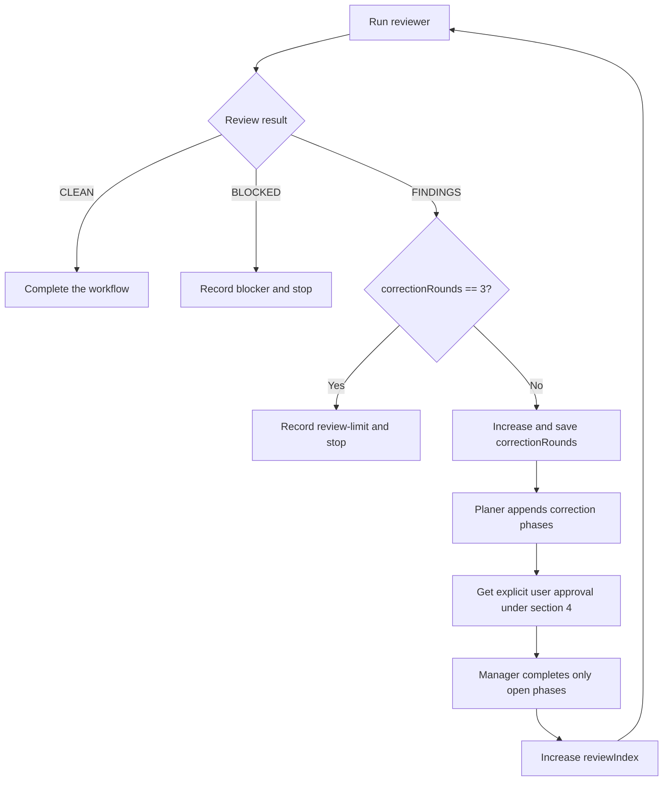

# Main Session workflow control

First, read all of `references/contract.md`.
Resolve this path relative to this skill directory.
Supply the absolute contract path to every subagent.
You are the Main Session, not an additional workflow subagent.

Use this workflow only at the user's explicit request.
Its invocation permits only the delegation specified below.
Do not start it automatically for ordinary coding tasks.

## 1. Preliminary checks and task directory

- If the request is empty, ask for the task or ticket first.
  Do not start agents yet.
- Check the Git repository, absolute root path, HEAD, and status, including untracked files.
  If the repository or HEAD is missing, stop.
  Ask the user for instructions.
  Do not initialize the repository yourself.
  If unrelated changes or another active workflow share this checkout, pause before branch creation or a worker launch.
  Do not clean up or stash changes automatically.
- Use `subagent({action:"list", options:{capabilities:true}})` to check the available roles.
  Check that exactly the six expected `pi-workflows.*` agents come from this package.
  Check that higher-priority overrides do not make unwanted changes to role permissions.
  If the tool is unavailable, use its existing discovery or enable mechanism, if available.
  Otherwise, report a setup blocker.
- Check that the setup installs and loads Pi and `npm:pi-subagents` separately.
  Do not install them yourself.
  Nested delegation requires an effective depth of at least 2, the default in compatible pi-subagents versions.
  Do not increase stricter user limits.
  Manager can start only worker or advisor.
  Planer can start only advisor.
- Always start researcher with `async:true` so that the runtime loads ambient MCP extensions.
  The default selectors are `linear`, `gitea`, and `github`.
  Users must configure these servers or adapt the researcher tools through `subagents.agentOverrides`.
  Use their server names and required read-only tools as described in the README.
  Do not treat missing servers, authentication, or tools as empty research results.
  Do not omit required external context without notice.
- Use one task directory per active Pi session.
  For another invocation in the same session, reuse the known TASK_DIR.
  Do not create a directory for each subagent or review.
  For a new independent task, ask the user to start a new session.
  Use a new UUID for a new session.
  For explicit `resume /absolute/path`, check existing metadata first.
  Continue only the same task.
  Do not use a global `latest` pointer.
- Create a new directory exclusively with Node, which Pi and npm already require:

```bash
node --input-type=module -e '
import { randomUUID } from "node:crypto";
import { mkdirSync } from "node:fs";
import { homedir } from "node:os";
import { join } from "node:path";
const root = join(homedir(), ".pi", "tasks");
mkdirSync(root, { recursive: true, mode: 0o700 });
const dir = join(root, randomUUID());
mkdirSync(dir, { mode: 0o700 });
console.log(dir);
'
```

Save the absolute path from the command output.
Give this path to the user.
Create `request.md` with the original request, repository, initial branch and commit, and scope.
Create `state.json` with these fields:

- `schemaVersion`: 1
- `taskId`: UUID
- `taskDir`
- `repo`
- `sessionReference`: use the available reference; do not invent one
- `baseBranch`
- `baseCommit`
- `featureBranch`: initially null
- `stage`
- `correctionRounds`: 0
- `reviewIndex`: 0
- `activeRun`: null
- `planApproval`: null
- `history`: []

Only Main writes this file.
Use atomic file replacement for each write.
Before and after each call, save stage transitions, run IDs, results, and artifact paths.
Only one Main Session can resume a task at a time.

## 2. Shared call protocol

Use native `subagent` calls.
Do not use RPC, CLI, workflow-script, or chain adapters.
Select each agent by its namespaced name.
Set an explicit `cwd: REPO` and `async:true` for each launch.
Include all contract handoff fields in every assignment.
Include the contract path, exact output paths, and explicit delegation permissions for planer and manager.
You can set `options.sessionDir` to a role-specific or round-specific directory under `TASK_DIR/sessions`.
The runtime continues to manage native debug and run metadata.

After launch, save the run ID in `state.activeRun`.
Do not start the next stage yet.
In interactive Main, wait for native completion by yielding control.
Do not poll or wait with unnecessary blocking calls.
After wake-up, check the result and status with the exact run ID.
Read the report.
Check the expected path, file, and role status.
A launch receipt is not DONE.
For missing or different artifacts, errors, timeouts, or unclear results, report BLOCKED.
Do not route a raw response through `output` to `plan.md` or another report that the agent writes directly.
The agent writes the report.
Its return message contains only status and path.

For blockers, set `stage: blocked`.
Record the error, run ID, and partial changes.
Inform the user.
Stop.
Do not start an automatic unlimited retry loop.
Before you start the next role, make sure that the previous agent and all its workers are inactive.

## 3. Research, questions, feature branch, and plan

1. Start `pi-workflows.researcher` with the original request.
   Set its output path to `TASK_DIR/research.md`.
2. Read the report.
   Ask the user all open questions together before planning or implementation.
   Add the answers to `request.md`.
   Other open questions can remain until completion if the user explicitly approves the associated assumptions.
   For questions that prevent progress, wait for answers.
   Do not guess requirements.
3. After successful research and the necessary answers, check Git status again.
   Create a new local feature branch from the recorded HEAD:
   `git switch -c feature/<short-safe-slug>-<task-uuid>`.
   Use only lowercase letters, digits, and hyphens in the slug.
   Always quote arguments safely.
   Use `git check-ref-format --branch` first.
   Never overwrite an existing branch.
   Check that the base HEAD did not change.
   If it changed, pause.
   Save the branch in state.
4. Start `pi-workflows.planer` with `research.md`, `request.md`, the base commit, and the branch.
   Set its output path to `TASK_DIR/plan.md`.
   Permit delegation only to `pi-workflows.advisor` for limited planning questions.
5. Read the plan.
   Check its full scope, nested checkboxes, unique IDs, dependencies, and measurable acceptance criteria.
   Ask the user any new questions that prevent progress.

## 4. Plan approval and sequential implementation

After EVERY successful `planer` run, pause for user approval.
This includes the initial plan, requested changes, and review corrections.

1. Check the plan.
   Atomically save `planApproval: null`, `activeRun: null`, and `stage: awaiting-plan-approval`.
   Calculate the SHA-256 of the current `plan.md` for approval.
2. Give the user a short summary of phases, affected files, risks, and checks.
   Include the absolute path to `plan.md`.
   Ask explicitly whether to implement this plan or change it.
   Yield control to the user.
   Then wait for the answer.
   Do not start manager or worker without approval.
   Do not implement changes yourself while approval is missing.
   An error-free plan is not approval.
3. Accept only explicit user approval of the current plan that you presented.
   Workflow invocation, planer DONE, silence, a dismissed question, and resume alone are not approval.
   Record the answer in `request.md` and `history`.
   After approval, save `planApproval` with `planSha256` and `response`.
   Then set `stage: implementing`.
4. For requested changes, record them in `request.md`.
   Assign the plan to planer again.
   Repeat the same approval step after that run.
   If the user rejects the plan, remain paused.
   A changed plan invalidates earlier approval.

Before every manager launch, check the explicit approval for the current plan.
Its SHA-256 must match `planApproval.planSha256`.
If approval is missing or the plan differs, return to the user approval pause.
Explicitly include the approval data in the manager assignment.
Manager checkbox changes and execution notes during an approved run do not require new approval.
Before another manager launch, apply the approval check again.

Supply `plan.md` and all context paths to `pi-workflows.manager`.
Set its report path to `manager-round-0.md`, or use the later round number.
Explicitly permit delegation only to `pi-workflows.worker` and `pi-workflows.advisor`.
Require sequential execution.
Manager completes all open phases with exactly one worker at a time.
After DONE, read the plan yourself.
Every phase and task must have `[x]` and supporting evidence.
Do not claim review success for BLOCKED, open checkboxes, or failed checks.

## 5. Review with no more than three correction rounds

Main controls the correction counter.
Start with `correctionRounds=0` and `reviewIndex=0`.
One initial review and at most three correction rounds permit a maximum of four reviews.



For each review, start `pi-workflows.reviewer` with the request, research, current plan, and full repository diff from `baseCommit`.
Include the index, working tree, and untracked product files.
Set its output path to `review-<reviewIndex>.md`.
Accept CLEAN only with sufficient check evidence.

For FINDINGS at `correctionRounds == 3`, set `stage: review-limit`.
Record open findings in `summary.md`.
Inform the user.
Stop.
Do not start a fourth correction round or claim completion.
Do not restart automatically with a reset counter.

For FINDINGS below the limit, increase and save `correctionRounds` by 1 before correction starts.
Supply the review report and existing `plan.md` to `pi-workflows.planer`.
Require only appended correction phases and tasks.
Keep existing checkboxes unchanged.
Check that the new tasks cover all findings.
Get plan approval under section 4.
Only then start manager for the open phases.
Use `manager-round-<correctionRounds>.md` for its report.
Wait for full completion.
Increase `reviewIndex` before the next review.
BLOCKED is not FINDINGS and does not permit an automatic correction retry.

## 6. Completion and resume

After CLEAN and full plan completion, set `stage: complete`.
Create `summary.md`.
Report the summary, branch, test results, and any remaining questions with approved assumptions.
Include absolute paths to the task directory, research, plan, and last review.
Do not create commits, pushes, or pull requests.

After interruption, read `state.json`, `request.md`, the plan, existing reports, and exact active run IDs.
Check the repository, branch, base commit, and session association.
First, check active runs with status.
If run status is unclear, pause.
Never start duplicate workers.
If interrupted writes leave the run, result, or metadata unclear, ask the user for a decision.
Never reset `correctionRounds` or `reviewIndex` to 0.
Do not create a new branch on resume.
Do not repeat completed phases.
A new session can take over an old task only through explicit resume.

For `stage: awaiting-plan-approval`, present the plan again.
Wait for explicit approval.
Resume alone does not approve implementation.
Missing `planApproval` data in older tasks is not approval.
Before a new manager launch, check approval under section 4.
Neither resume nor native completion can bypass this pause.
